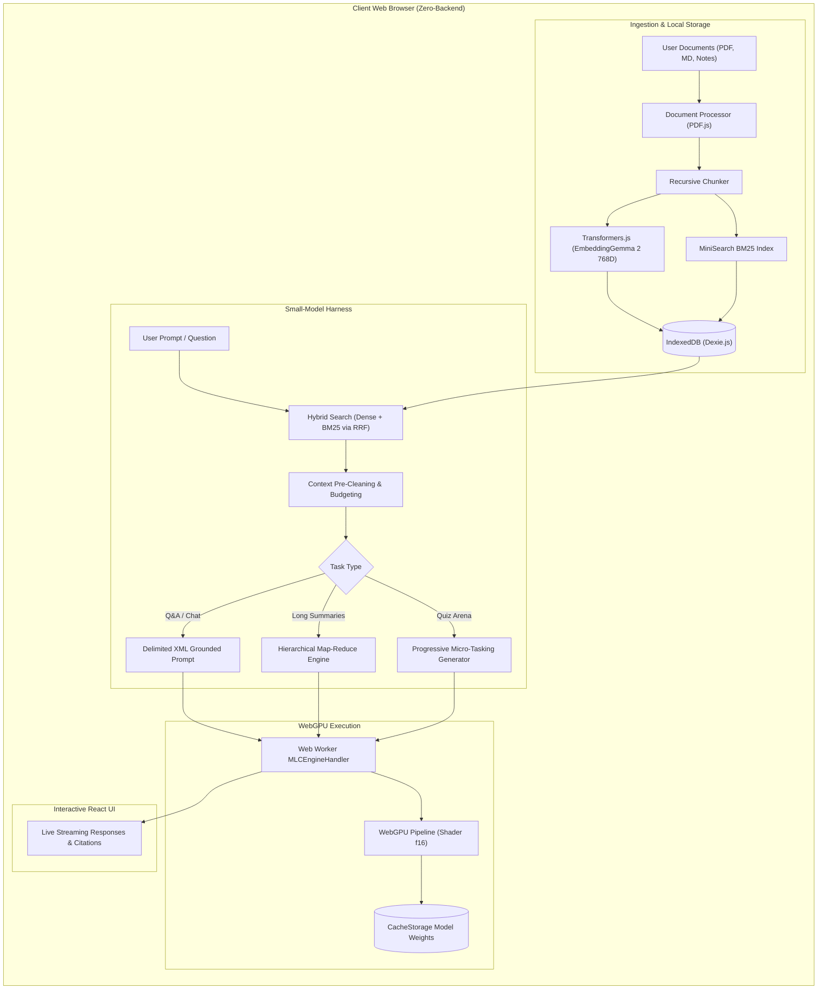

# DocuBrain AI Overview & Architecture

**DocuBrain AI** is a client-side, local-first documentation learning assistant designed to run large language models and retrieval pipelines directly inside the user's web browser using **WebGPU** and **WebLLM**.

Inspired by [rimc008/Rag_project2](https://github.com/rimc008/Rag_project2), DocuBrain AI eliminates all backend server requirements (FastAPI, Qdrant, external API endpoints) by executing document ingestion, semantic embeddings, lexical indexing, and model inference entirely on client hardware.

---

## 1. Core Principles

1. **Zero-Backend & Complete Privacy**:
   - No text, embeddings, or prompts leave the client machine.
   - Hostable as a static single-page application on **GitHub Pages**.
2. **Specialized Small-Model Harness**:
   - Small models (0.5B to 4B parameters) running in consumer browser environments possess restricted KV caches and attention budgets.
   - The harness optimizes performance through context pre-cleaning, strict token budgeting, Jaccard deduplication, hierarchical Map-Reduce summarization, and progressive single-question quiz generation.
3. **Hybrid Information Retrieval**:
   - Merges dense semantic vector similarity ([`EmbeddingGemma 2`](file:///E:/0-Antigravity/0-webllm/openwiki/models-and-webgpu.md)) with sparse lexical BM25 indexing ([`MiniSearch`](file:///E:/0-Antigravity/0-webllm/openwiki/rag-and-small-model-harness.md)) using Reciprocal Rank Fusion (RRF).
4. **Fluid 60 FPS User Experience**:
   - Heavy neural weight streaming, shader execution, and token generation run off-thread in a dedicated Web Worker ([`src/lib/llm/webllmWorker.ts`](file:///E:/0-Antigravity/0-webllm/src/lib/llm/webllmWorker.ts)).

---

## 2. Key Technology Stack

| Layer | Technologies | Purpose |
| :--- | :--- | :--- |
| **Frontend Framework** | React 19, TypeScript, Vite, Tailwind CSS | Reactive, responsive UI with light/dark theme support. |
| **Local LLM Engine** | `@mlc-ai/web-llm` | WebGPU-accelerated in-browser inference for Gemma 4, Qwen 2.5, and Llama 3.2. |
| **Embeddings** | `@huggingface/transformers` | Client-side ONNX feature extraction using EmbeddingGemma 2 (270M) and all-MiniLM-L6-v2. |
| **Lexical Search** | `minisearch` | In-memory BM25 sparse search with fuzzy matching and prefix support. |
| **PDF Extraction** | `pdfjs-dist` | In-browser PDF text and page parsing. |
| **Local Storage** | `dexie` (IndexedDB) | Relational client-side persistence for documents, chunks, vectors, notes, and quizzes. |
| **Animations** | `canvas-confetti`, `lucide-react` | Celebratory quiz completion interactions and modern iconography. |
| **Deployment** | GitHub Actions (`.github/workflows/deploy.yml`) | Automated static site compilation and deployment to GitHub Pages. |

---

## 3. Related Documentation

<!-- openwiki: broken internal link [/openwiki/quickstart.md] link "/openwiki/quickstart.md" is root-absolute, which no real consumer resolves against the repository root (not a coding agent reading the page, not GitHub's Markdown renderer, not a local viewer); use a path relative to this file instead. Fix the href or restore the target, then delete this comment. -->
- [DocuBrain AI Quickstart & Deployment](/openwiki/quickstart.md): Step-by-step installation, local dev, and GitHub Pages publishing.
<!-- openwiki: broken internal link [/openwiki/rag-and-small-model-harness.md] link "/openwiki/rag-and-small-model-harness.md" is root-absolute, which no real consumer resolves against the repository root (not a coding agent reading the page, not GitHub's Markdown renderer, not a local viewer); use a path relative to this file instead. Fix the href or restore the target, then delete this comment. -->
- [Small-Model RAG Harness & Hybrid Retrieval](/openwiki/rag-and-small-model-harness.md): In-depth mechanics of RRF hybrid retrieval, context compression, and micro-tasking.
<!-- openwiki: broken internal link [/openwiki/models-and-webgpu.md] link "/openwiki/models-and-webgpu.md" is root-absolute, which no real consumer resolves against the repository root (not a coding agent reading the page, not GitHub's Markdown renderer, not a local viewer); use a path relative to this file instead. Fix the href or restore the target, then delete this comment. -->
- [WebLLM & Embedding Models](/openwiki/models-and-webgpu.md): Specifications for Gemma 4 E2B/E4B, EmbeddingGemma 2 (270M), and WebGPU acceleration.
<!-- openwiki: broken internal link [/openwiki/ingestion-and-storage.md] link "/openwiki/ingestion-and-storage.md" is root-absolute, which no real consumer resolves against the repository root (not a coding agent reading the page, not GitHub's Markdown renderer, not a local viewer); use a path relative to this file instead. Fix the href or restore the target, then delete this comment. -->
- [Document Ingestion & Local Storage](/openwiki/ingestion-and-storage.md): PDF parsing, recursive chunking, and IndexedDB data models.
<!-- openwiki: broken internal link [/openwiki/ui-and-learning-suite.md] link "/openwiki/ui-and-learning-suite.md" is root-absolute, which no real consumer resolves against the repository root (not a coding agent reading the page, not GitHub's Markdown renderer, not a local viewer); use a path relative to this file instead. Fix the href or restore the target, then delete this comment. -->
- [User Interface & Interactive Learning Suite](/openwiki/ui-and-learning-suite.md): Conversational Q&A, Map-Reduce summaries, smart notes, quiz arena, and chunk inspector.
